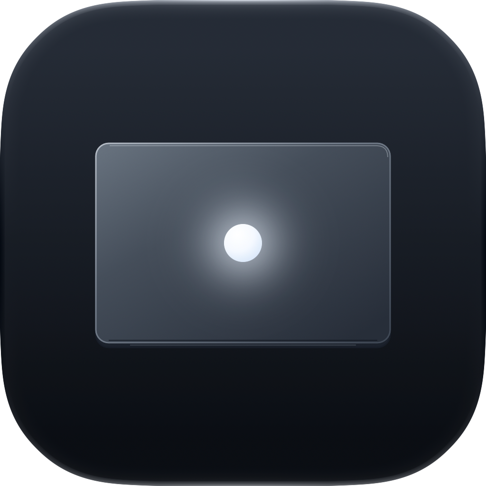

<!-- SPDX-FileCopyrightText: 2026 Nick Wolff <nick@wolff.tech> -->
<!-- SPDX-License-Identifier: GPL-2.0-only -->

<p align="center">
  
</p>

<h1 align="center">Logo Glow</h1>

<p align="center">
  Take manual control of the illuminated Apple logo on your MacBook Pro.
</p>

The new MacBook Pro with PROLED XDR display brings back the glowing Apple logo
on the lid. macOS sets its brightness automatically from the display brightness
and ambient light, and the only built-in control is a Terminal command that turns
it off. Logo Glow is a menu bar app that lets you decide how the logo glows.

## What it does

- Lives in the menu bar
- Hands control of the logo back and forth with one toggle: off leaves it to
  macOS, on lets Logo Glow drive it
- Turns the logo off, or sets its brightness independently of the display
- Optionally lifts the ambient-light limits macOS puts on logo brightness, so
  the full range from off to 1,000 nits is available (needs an admin password)
- Hands the logo back to macOS when you quit, and takes it again at the next launch

Changes apply within about a second, without touching your screen brightness.

## Installation

Logo Glow requires a MacBook Pro with PROLED XDR display (the models with an
illuminated Apple logo) running macOS 27 or later. It does nothing on other Macs.

### Manual download

1. Download the signed `.dmg` from [GitHub Releases](https://github.com/WolffTech/logoglow/releases), or [build from source](#build-from-source).
2. Open the disk image and drag Logo Glow to `/Applications`.
3. Launch Logo Glow from `/Applications`. It appears in the menu bar.

## Build from source

Install Xcode 27 or later (the build compiles the Icon Composer app icon with
`actool`), then run:

```sh
git clone https://github.com/WolffTech/logoglow.git
cd logoglow
./Scripts/make-app.sh
open "dist/Logo Glow.app"
```

For development:

```sh
swift build
swift test
swift run LogoGlow
```

Maintainers can find the CI checks, release process, and signing setup in
[RELEASING.md](RELEASING.md).

## License

Logo Glow is free software licensed under [GPL-2.0-only](LICENSE). Each
release includes a matching source archive.
